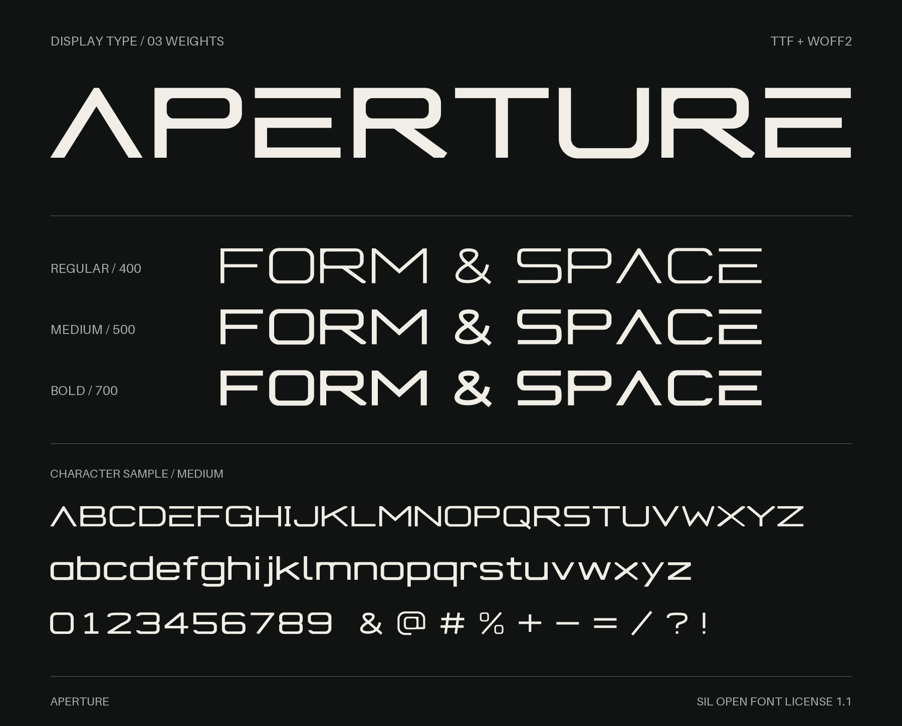
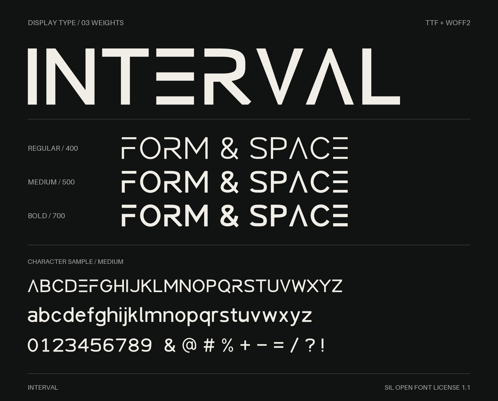

# Fonts

Aperture and Interval: original Latin display fonts, desktop and webfont files, and editable outline sources.

| Family | Weights | Download |
| --- | --- | --- |
| [Aperture](aperture/) | Regular, Medium, Bold | [Aperture ZIP](dist/aperture.zip) |
| [Interval](interval/) | Regular, Medium, Bold | [Interval ZIP](dist/interval.zip) |

## Aperture

Wide geometric forms with a barless A and an open E.



## Interval

Compact geometric forms with a barless A, a three-bar E, a detached top bar on F, and an open upper stem on R.



## Install

Download a family archive, extract it, and install its `.ttf` files with your operating system's font manager. For websites, use the `.woff2` files and the stylesheet supplied with each family.

Interval 1.103 includes the barless A and open R as its standard forms. Replace older Interval installations with the current files, and uninstall Interval Barless or Interval Open if present. Restart applications that cache installed fonts.

Each font supports 366 characters, including Latin extensions, tabular numerals, punctuation, and combining accents. These are upright, unhinted display fonts. They have no italic styles or variable axes.

## Build

Each family's README contains its rebuild commands and prerequisites. The sources require Python 3.10 or later and HarfBuzz's `hb-shape` command.

To package the current font files into separate archives, run:

```sh
python3 tools/package.py
```

The command writes `dist/aperture.zip`, `dist/interval.zip`, and `dist/SHA256SUMS`. The archives contain fonts, stylesheets, build sources, and usage instructions.

To regenerate the README previews from the supplied TTF files, install `tools/preview-requirements.txt` in your Python environment. With HarfBuzz's `hb-view` command on your path, run `python3 tools/preview.py`.

## License

The fonts, outline sources, build scripts, stylesheets, and accompanying documentation are licensed under the [SIL Open Font License 1.1](LICENSE). No Reserved Font Names are declared.
